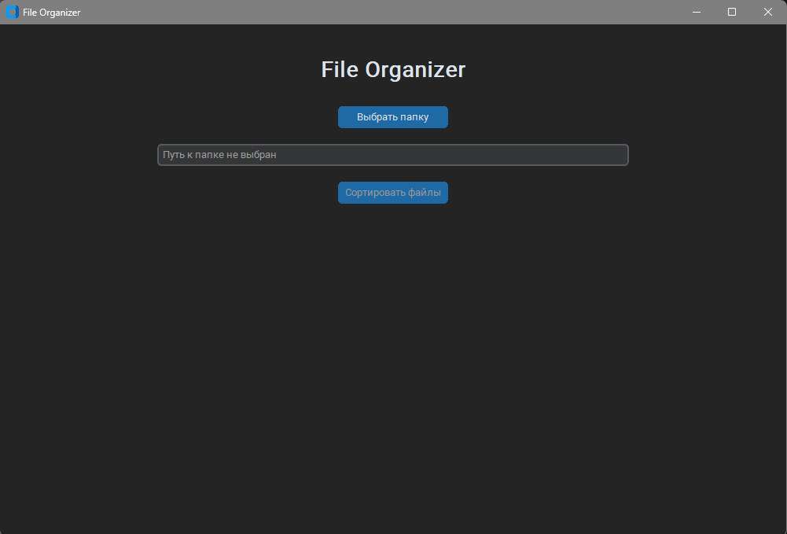
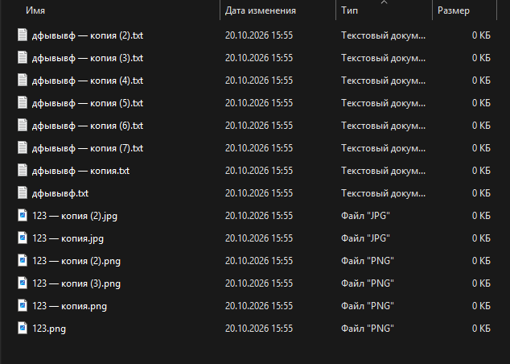

# File Organizer

Десктопное приложение на Python для автоматической сортировки файлов по категориям. Выберите папку — программа разложит файлы по подпапкам.


## Скриншоты

**Главное окно**



**До сортировки**



**После сортировки**


## Возможности

- Выбор папки через системный диалог
- **Предпросмотр** — список планируемых перемещений (`файл → категория`) и сводка по категориям до внесения изменений
- **Отмена** — откат последней сортировки: файлы возвращаются на исходные места, а созданные пустые подпапки удаляются. Если часть файлов вернуть не удалось (например, заняты), отмену можно повторить
- **Открыть папку** — быстрый переход к выбранной папке в Проводнике
- Автоматическая сортировка файлов по категориям (см. [Категории](#категории))
- Подпапки создаются автоматически
- Служебные и временные файлы (`desktop.ini`, `Thumbs.db`, `~$*.docx`, `*.crdownload`, `*.part`, `*.tmp`) не трогаются
- Разрешение конфликтов имён: при совпадении добавляется суффикс `имя (1).ext`
- Обработка ошибок: занятые файлы и проблемы доступа не «роняют» приложение
- Тёмная тема оформления (синий акцент)

> **Важно:** отмена доступна только для **последней** операции и хранится в памяти.
> После закрытия приложения история откатов недоступна.

## Как это работает

1. Вы выбираете папку через диалог.
2. **Предпросмотр** строит план: приложение сканирует файлы в корне папки и сопоставляет расширение с категорией.
3. **Сортировать файлы** применяет план: файлы перемещаются в подпапки категорий.
4. **Отменить** возвращает файлы последней операции на исходные места.

Сканируются только файлы в корне выбранной папки — уже существующие подпапки не затрагиваются.

## Категории

| Категория | Расширения |
|-----------|------------|
| **Изображения** | `.jpg`, `.jpeg`, `.png`, `.gif`, `.bmp`, `.webp`, `.svg`, `.ico`, `.tif`, `.tiff`, `.heic`, `.avif`, `.raw`, `.psd` |
| **Документы** | `.pdf`, `.docx`, `.doc`, `.txt`, `.rtf`, `.odt`, `.md`, `.pages`, `.tex` |
| **Таблицы** | `.xlsx`, `.xls`, `.csv`, `.ods`, `.tsv`, `.numbers` |
| **Презентации** | `.pptx`, `.ppt`, `.odp`, `.key` |
| **Видео** | `.mp4`, `.avi`, `.mkv`, `.mov`, `.wmv`, `.webm`, `.flv`, `.m4v` |
| **Аудио** | `.mp3`, `.wav`, `.flac`, `.aac`, `.ogg`, `.m4a`, `.wma`, `.opus` |
| **Архивы** | `.zip`, `.rar`, `.7z`, `.tar`, `.gz`, `.bz2`, `.xz` |
| **Код** | `.py`, `.js`, `.ts`, `.jsx`, `.tsx`, `.json`, `.html`, `.css`, `.scss`, `.java`, `.cpp`, `.c`, `.h`, `.hpp`, `.cs`, `.go`, `.rs`, `.php`, `.rb`, `.swift`, `.kt`, `.sql`, `.sh`, `.ps1`, `.bat`, `.xml`, `.yml`, `.yaml`, `.toml`, `.ini` |
| **Шрифты** | `.ttf`, `.otf`, `.woff`, `.woff2` |
| **Программы** | `.exe`, `.msi`, `.apk`, `.deb`, `.dmg`, `.appx` |
| **Книги** | `.epub`, `.mobi`, `.fb2`, `.djvu`, `.azw3` |
| **Прочее** | все остальные расширения |

Список категорий и расширений настраивается в `core/rules.py`.

## Стек

- Python 3.11
- [CustomTkinter](https://github.com/TomSchimansky/CustomTkinter) (>= 5.2.0)
- PyInstaller (>= 6.0) — сборка `.exe`

## Требования

- Windows (сборка и запуск `.exe` ориентированы на Windows)
- Python 3.11 для запуска из исходников

## Запуск из исходников

```bash
pip install -r requirements.txt
python main.py
```

## Тесты

```bash
pip install -r requirements-dev.txt
python -m pytest
```

Тесты покрывают разбор расширений, построение плана, перенос файлов, конфликты имён и отмену. CI прогоняет их на Windows при каждом пуше и пул-реквесте.

## Сборка .exe

```bash
build.bat
```

Скрипт устанавливает зависимости из `requirements-dev.txt` и собирает приложение через PyInstaller в режиме `--onefile --windowed` с `--collect-all customtkinter`. Готовый файл появится в `dist\FileOrganizer.exe`.

## Структура проекта

```
file-organizer/
├── main.py                    # точка входа
├── config.py                  # настройки приложения (название, размер, тема)
├── build.bat                  # сборка .exe
├── FileOrganizer.spec         # спецификация PyInstaller
├── requirements.txt           # зависимости приложения
├── requirements-dev.txt       # зависимости для сборки
├── assets/
│   └── screenshots/           # скриншоты для README
├── tests/                     # pytest-тесты ядра
├── .github/workflows/         # CI: запуск тестов
├── ui/
│   ├── __init__.py
│   └── app.py                 # главное окно и обработка действий
└── core/
    ├── __init__.py
    ├── organizer.py           # логика сортировки, предпросмотра и отмены
    └── rules.py               # категории, расширения и служебные файлы
```

Папки `build/` и `dist/` создаются PyInstaller автоматически.

## Лицензия

MIT — см. [LICENSE](LICENSE).
