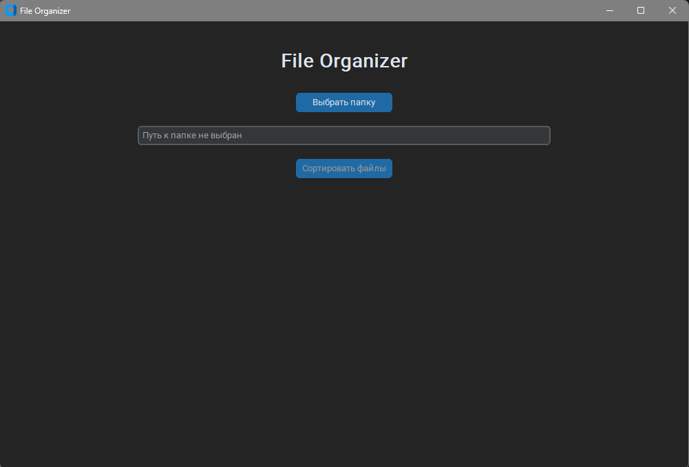
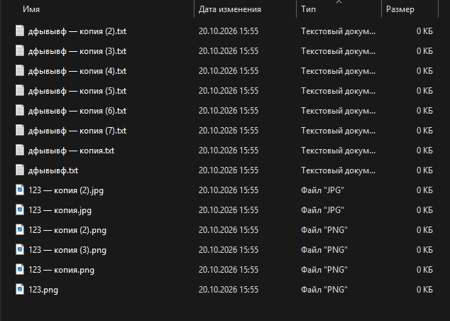
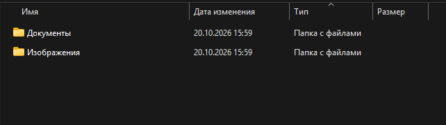

# 🗂 File Organizer

[](https://www.python.org/)
[](https://github.com/TomSchimansky/CustomTkinter)
[](https://pyinstaller.org/)
[]()
[](LICENSE)

A Python desktop app that automatically sorts files into categories. Pick a
folder and the app files everything into subfolders — with a **preview** before it
touches anything and a one-click **undo**.

## 📸 Screenshots

**Main window**



**Before sorting**



**After sorting**



## ✨ Features

- Folder picker via the native system dialog.
- **Preview** — a list of planned moves (`file → category`) before anything changes.
- **Undo** — reverts the last sort: files go back to their original locations and
  empty folders created by the app are removed.
- Automatic sorting of files into categories (see [Categories](#-categories)).
- Category subfolders are created automatically.
- Name-conflict resolution: a `name (1).ext` suffix is added on collision.
- Error handling: locked files and access issues never crash the app.
- Dark theme with a blue accent.

> **Note:** undo is available only for the **last** operation and is kept in
> memory. After closing the app, the undo history is gone.

## ⚙️ How it works

1. You pick a folder through the dialog.
2. **Preview** builds the plan: the app scans the files in the folder root and maps
   each extension to a category.
3. **Sort files** applies the plan: files are moved into the category subfolders.
4. **Undo** returns the files from the last operation to their original locations.

Only files in the root of the selected folder are scanned — existing subfolders are
left untouched.

## 🗂 Categories

Folder names are created as shown in parentheses.

| Category | Extensions |
|----------|------------|
| **Images** (Изображения) | `.jpg`, `.jpeg`, `.png`, `.gif`, `.bmp`, `.webp`, `.svg`, `.ico` |
| **Documents** (Документы) | `.pdf`, `.docx`, `.doc`, `.txt`, `.rtf`, `.odt` |
| **Spreadsheets** (Таблицы) | `.xlsx`, `.xls`, `.csv`, `.ods` |
| **Video** (Видео) | `.mp4`, `.avi`, `.mkv`, `.mov`, `.wmv`, `.webm` |
| **Audio** (Аудио) | `.mp3`, `.wav`, `.flac`, `.aac`, `.ogg`, `.m4a` |
| **Archives** (Архивы) | `.zip`, `.rar`, `.7z`, `.tar`, `.gz` |
| **Code** (Код) | `.py`, `.js`, `.ts`, `.jsx`, `.tsx`, `.json`, `.html`, `.css`, `.java`, `.cpp`, `.c`, `.h`, `.cs`, `.go`, `.rs`, `.php`, `.xml`, `.yml`, `.yaml` |
| **Fonts** (Шрифты) | `.ttf`, `.otf`, `.woff`, `.woff2` |
| **Programs** (Программы) | `.exe`, `.msi`, `.apk`, `.deb`, `.dmg` |
| **Books** (Книги) | `.epub`, `.mobi`, `.fb2`, `.djvu` |
| **Other** (Прочее) | every other extension |

The category list and extensions are configurable in `core/rules.py`.

## 🧰 Tech stack

- Python 3.11
- [CustomTkinter](https://github.com/TomSchimansky/CustomTkinter) (>= 5.2.0)
- PyInstaller (>= 6.0) — `.exe` build

## 🧩 Requirements

- Windows (the build and `.exe` are Windows-oriented)
- Python 3.11 to run from source

## ▶ Run from source

```bash
pip install -r requirements.txt
python main.py
```

## 🧪 Tests

```bash
pip install -r requirements-dev.txt
python -m pytest
```

The tests cover the category rules in `core/rules.py` and the sorting, conflict
resolution, and undo logic in `core/organizer.py`. They run automatically on every
push and pull request through GitHub Actions.

## 🛠 Build a standalone .exe

```bash
build.bat
```

The script installs dependencies from `requirements-dev.txt` and builds the app
with PyInstaller in `--onefile --windowed` mode with `--collect-all customtkinter`.
The result appears at `dist\FileOrganizer.exe`.

## 🏗 Project structure

```
file-organizer/
├── main.py                    # entry point
├── config.py                  # app settings (name, size, theme)
├── build.bat                  # .exe build script
├── requirements.txt           # runtime dependencies
├── requirements-dev.txt       # build and test dependencies
├── pyproject.toml             # pytest configuration
├── assets/
│   └── screenshots/           # README screenshots
├── tests/
│   ├── test_organizer.py      # sorting, conflicts and undo
│   └── test_rules.py          # category rules
├── ui/
│   ├── __init__.py
│   └── app.py                 # main window and action handling
└── core/
    ├── __init__.py
    ├── organizer.py           # sorting, preview, and undo logic
    └── rules.py               # categories and extensions
```

The `build/` and `dist/` folders are created by PyInstaller automatically.

## 📜 License

MIT — see [LICENSE](LICENSE).

---

## 📫 Contact

Open to freelance work and collaborations.

- Email: **bottiktik123@gmail.com**
- GitHub: [@bottk123-ctrl](https://github.com/bottk123-ctrl)
- Portfolio: [github.com/bottk123-ctrl/portfolio](https://github.com/bottk123-ctrl/portfolio)
