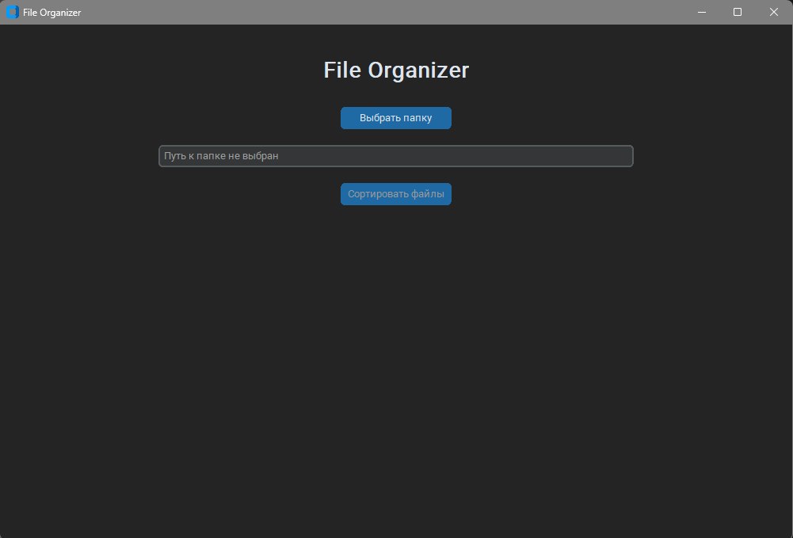
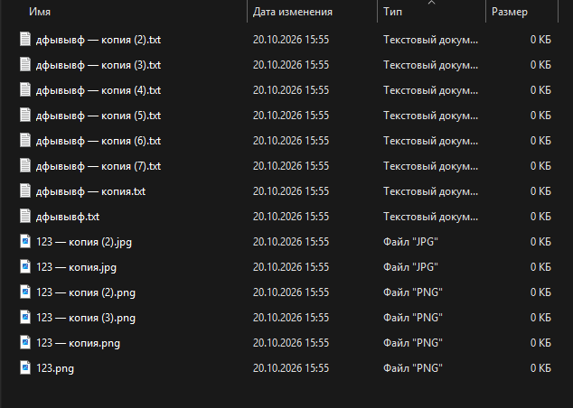
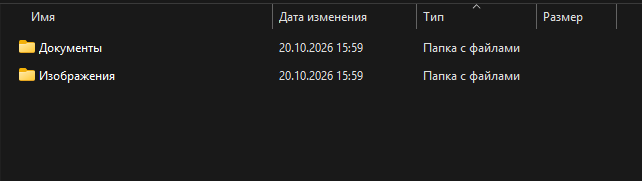

# File Organizer

Десктопное приложение на Python для автоматической сортировки файлов по категориям. Выберите папку — программа разложит файлы по подпапкам.


## Скриншоты

**Главное окно**



**До сортировки**



**После сортировки**



## Возможности

- Выбор папки через системный диалог
- **Предпросмотр** — список планируемых перемещений до внесения изменений
- **Отмена** — откат последней сортировки (файлы возвращаются на место)
- Автоматическая сортировка файлов по категориям:
  - **Изображения** — `.jpg`, `.jpeg`, `.png`, `.gif`, `.bmp`, `.webp`, `.svg`, `.ico`
  - **Документы** — `.pdf`, `.docx`, `.doc`, `.txt`, `.rtf`, `.odt`
  - **Таблицы** — `.xlsx`, `.xls`, `.csv`, `.ods`
  - **Видео** — `.mp4`, `.avi`, `.mkv`, `.mov`, `.wmv`, `.webm`
  - **Аудио** — `.mp3`, `.wav`, `.flac`, `.aac`, `.ogg`, `.m4a`
  - **Архивы** — `.zip`, `.rar`, `.7z`, `.tar`, `.gz`
  - **Код** — `.py`, `.js`, `.ts`, `.json`, `.html`, `.css` и др.
  - **Шрифты** — `.ttf`, `.otf`, `.woff`, `.woff2`
  - **Программы** — `.exe`, `.msi`, `.apk`, `.deb`, `.dmg`
  - **Книги** — `.epub`, `.mobi`, `.fb2`, `.djvu`
  - **Прочее** — все остальные расширения
- Подпапки создаются автоматически
- Разрешение конфликтов имён: при совпадении добавляется суффикс `имя (1).ext`
- Обработка ошибок: занятые файлы и проблемы доступа не «роняют» приложение
- Тёмная тема оформления

## Стек

- Python 3.11
- [CustomTkinter](https://github.com/TomSchimansky/CustomTkinter)
- PyInstaller (сборка `.exe`)

## Запуск из исходников

```bash
pip install -r requirements.txt
python main.py
```

## Сборка .exe

```bash
build.bat
```

Готовый файл появится в `dist\FileOrganizer.exe`. Сборка выполняется через PyInstaller в режиме `--onefile --windowed`.

## Структура проекта

```
file-organizer/
├── main.py              # точка входа
├── config.py            # настройки приложения
├── build.bat            # сборка .exe
├── requirements.txt
├── requirements-dev.txt
├── ui/
│   └── app.py           # главное окно
└── core/
    ├── organizer.py     # логика сортировки
    └── rules.py         # категории и расширения
```

## Лицензия

MIT
