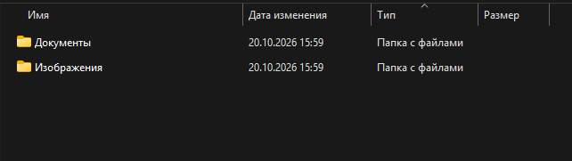

# 🗂 File Organizer

[](https://www.python.org/)
[](https://github.com/TomSchimansky/CustomTkinter)
[](https://pyinstaller.org/)
[]()
[](LICENSE)
[](https://github.com/bottk123-ctrl/file-organizer/actions/workflows/ci.yml)

A Python desktop app that automatically sorts files into categories. Pick a
folder and the app files everything into subfolders — with a **preview** before it
touches anything and a one-click **undo**.

## 📸 Screenshots

**Main window**


**Before sorting**


**After sorting**



## ✨ Features

- Folder picker via the native system dialog.
- **Preview** — a list of planned moves (`file → category`) plus a per-category
  summary before anything changes.
- **Undo** — reverts the last sort: files go back to their original locations and
  empty folders created by the app are removed. If some files could not be moved
  back (for example, they are locked), undo can be retried. The last sort is also
  remembered after a restart.
- **Command line mode** — sort, preview or undo a folder without opening a window
  (see [Command line](#-command-line)).
- **Open folder** — jump straight to the selected folder in Explorer.
- Automatic sorting of files into categories (see [Categories](#-categories)).
- Category subfolders are created automatically.
- Service and temporary files (`desktop.ini`, `Thumbs.db`, `~$*.docx`,
  `*.crdownload`, `*.part`, `*.tmp`) are left alone.
- Name-conflict resolution: a `name (1).ext` suffix is added on collision, and the
  destination is checked again right before the move, so a file that appeared while
  waiting for confirmation is never overwritten.
- Big folders stay responsive: sorting runs in a background thread and shows live
  progress (`N of M`).
- `--json` output for the command line, handy for scripts and the task scheduler.
- Error handling: locked files and access issues never crash the app.
- Dark theme with a blue accent.

> **Note:** only the **last** operation can be undone. Its history is kept in
> `%LOCALAPPDATA%\FileOrganizer\last-sort.json`, so undo still works after the app
> is restarted.

## ⚙️ How it works

1. You pick a folder through the dialog.
2. **Preview** builds the plan: the app scans the files in the folder root and maps
   each extension to a category.
3. **Sort files** applies the plan: files are moved into the category subfolders.
4. **Undo** returns the files from the last operation to their original locations.

Only files in the root of the selected folder are scanned — existing subfolders are
left untouched.

## 🗂 Categories

Folder names are created as shown in parentheses.

| Category | Extensions |
|----------|------------|
| **Images** (Изображения) | `.jpg`, `.jpeg`, `.png`, `.gif`, `.bmp`, `.webp`, `.svg`, `.ico`, `.tif`, `.tiff`, `.heic`, `.avif`, `.raw` |
| **Documents** (Документы) | `.pdf`, `.docx`, `.doc`, `.txt`, `.rtf`, `.odt`, `.md`, `.pages`, `.tex` |
| **Spreadsheets** (Таблицы) | `.xlsx`, `.xls`, `.csv`, `.ods`, `.tsv`, `.numbers` |
| **Presentations** (Презентации) | `.pptx`, `.ppt`, `.odp`, `.key` |
| **Video** (Видео) | `.mp4`, `.avi`, `.mkv`, `.mov`, `.wmv`, `.webm`, `.flv`, `.m4v` |
| **Audio** (Аудио) | `.mp3`, `.wav`, `.flac`, `.aac`, `.ogg`, `.m4a`, `.wma`, `.opus` |
| **Archives** (Архивы) | `.zip`, `.rar`, `.7z`, `.tar`, `.gz`, `.bz2`, `.xz` |
| **Code** (Код) | `.py`, `.js`, `.ts`, `.jsx`, `.tsx`, `.json`, `.html`, `.css`, `.scss`, `.java`, `.cpp`, `.c`, `.h`, `.hpp`, `.cs`, `.go`, `.rs`, `.php`, `.rb`, `.swift`, `.kt`, `.sh`, `.ps1`, `.bat`, `.xml`, `.yml`, `.yaml`, `.toml`, `.ini` |
| **Fonts** (Шрифты) | `.ttf`, `.otf`, `.woff`, `.woff2` |
| **Programs** (Программы) | `.exe`, `.msi`, `.apk`, `.deb`, `.dmg`, `.appx` |
| **Design** (Дизайн) | `.psd`, `.ai`, `.xd`, `.fig`, `.sketch` |
| **3D** (3D) | `.obj`, `.fbx`, `.stl`, `.blend`, `.3ds` |
| **Databases** (Базы данных) | `.sql`, `.db`, `.sqlite`, `.sqlite3`, `.mdb` |
| **Books** (Книги) | `.epub`, `.mobi`, `.fb2`, `.djvu`, `.azw3` |
| **Other** (Прочее) | every other extension |

The category list and extensions are configurable in `core/rules.py`.

## 🧰 Tech stack

- Python 3.11
- [CustomTkinter](https://github.com/TomSchimansky/CustomTkinter) (>= 5.2.0)
- PyInstaller (>= 6.0) — `.exe` build

## 🧩 Requirements

- Windows (the build and `.exe` are Windows-oriented)
- Python 3.11 to run from source

## ▶ Run from source

```bash
pip install -r requirements.txt
python main.py
```

## 🖥 Command line

The same logic works without the GUI — handy for scripts and task scheduler:

```bash
python main.py --folder "C:\Downloads" --dry-run   # показать план
python main.py --folder "C:\Downloads"             # спросить подтверждение
python main.py --folder "C:\Downloads" --yes       # переместить сразу
python main.py --undo                              # отменить последнюю сортировку
```

Exit code `0` means success, `1` means an error or a failed undo.

Add `--json` to get a machine-readable result instead of text (with a real sort,
`--yes` is required as well):

```bash
python main.py --folder "C:\Downloads" --dry-run --json
python main.py --folder "C:\Downloads" --yes --json
python main.py --undo --json
```

The JSON contains `mode`, the moved files with their categories, counters and an
`errors` list.

## 🧪 Tests

```bash
pip install -r requirements-dev.txt
python -m pytest
```

The tests cover the category rules in `core/rules.py` and the sorting, service-file
skipping, conflict resolution, and undo logic in `core/organizer.py`. They run
automatically on every push and pull request through GitHub Actions.

## 🛠 Build a standalone .exe

```bash
build.bat
```

The script installs dependencies from `requirements-dev.txt` and builds the app
with PyInstaller in `--onefile --windowed` mode with `--collect-all customtkinter`.
The result appears at `dist\FileOrganizer.exe`.

## 🏗 Project structure

```
file-organizer/
├── main.py                    # entry point
├── config.py                  # app settings (name, size, theme)
├── build.bat                  # .exe build script
├── requirements.txt           # runtime dependencies
├── requirements-dev.txt       # build and test dependencies
├── pyproject.toml             # pytest configuration
├── assets/
│   └── screenshots/           # README screenshots
├── tests/
│   ├── test_cli.py            # command line mode
│   ├── test_history.py        # saved undo history
│   ├── test_organizer.py      # sorting, conflicts and undo
│   └── test_rules.py          # category rules
├── ui/
│   ├── __init__.py
│   └── app.py                 # main window and action handling
└── core/
    ├── __init__.py
    ├── history.py             # last-sort history for undo
    ├── organizer.py           # sorting, preview, and undo logic
    └── rules.py               # categories, extensions and service files
```

The `build/` and `dist/` folders are created by PyInstaller automatically.

## 📦 Data files

The app stores its data in `%LOCALAPPDATA%\FileOrganizer`
(`last-sort.json` with the last operation). Override the location with the
`FILE_ORGANIZER_DATA_DIR` environment variable.

## 📜 License

MIT — see [LICENSE](LICENSE).

---

## 📫 Contact

Open to freelance work and collaborations.

- Email: **bottikt123@gmail.com**
- GitHub: [@bottk123-ctrl](https://github.com/bottk123-ctrl)
- Portfolio: [github.com/bottk123-ctrl/portfolio](https://github.com/bottk123-ctrl/portfolio)
